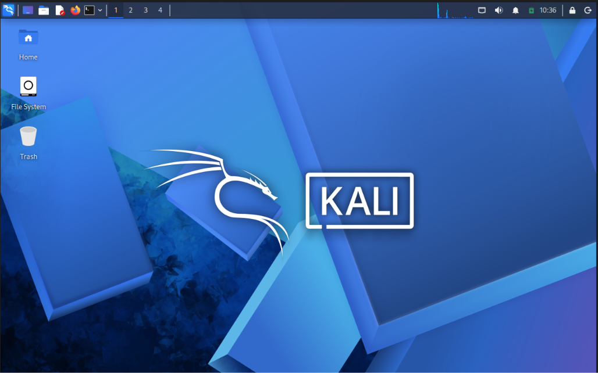
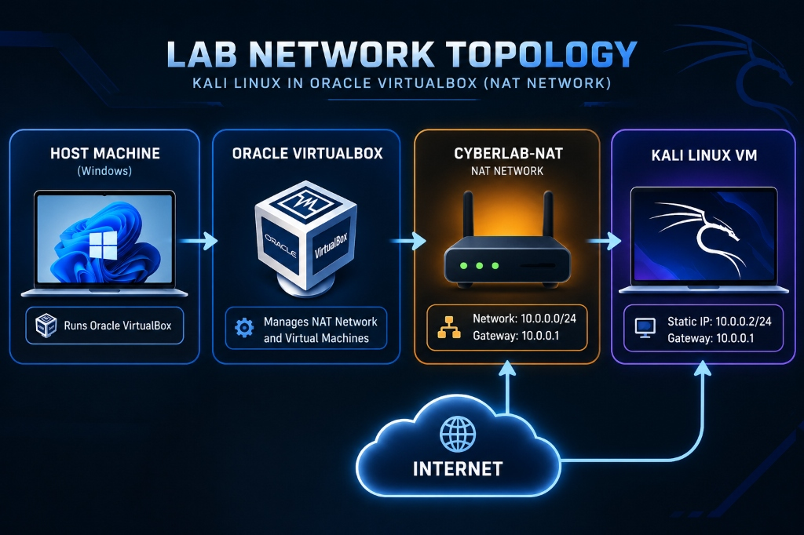
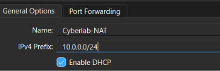
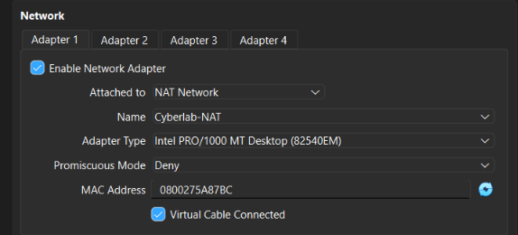
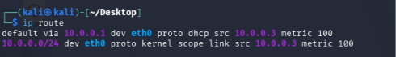
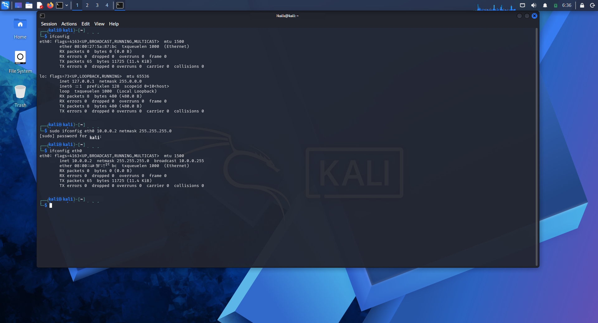
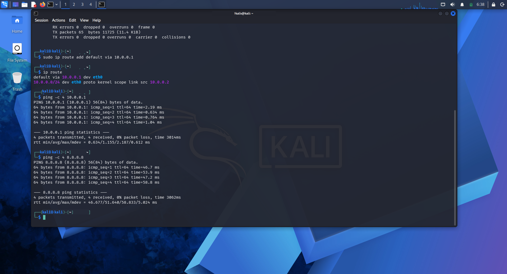
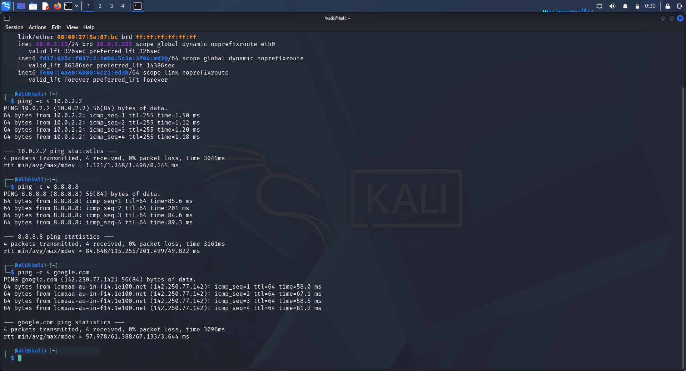
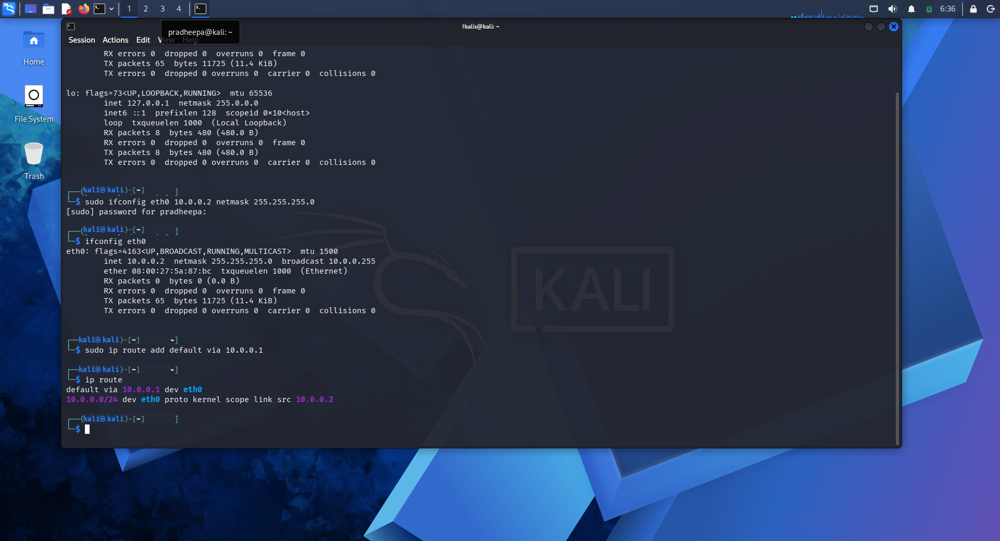
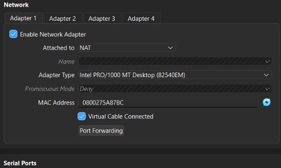

# Cybersecurity Laboratory Environment Setup

### *Oracle VirtualBox & Kali Linux Security Workstation*
**Networkwalks Cybersecurity Internship — Week 1 Project Module**

[](https://www.virtualbox.org/)
[](https://www.kali.org/)
[](#1-host-machine-specifications)
[](https://www.virtualbox.org/manual/ch06.html)
[](#author--internship-information)

---

## Visual Introduction


*Figure 1: Kali Linux 2026.2 security workstation desktop interface running within Oracle VirtualBox on physical host workstation.*

---

## Executive Summary

This documentation outlines the deployment, network engineering, and operational verification of an isolated cybersecurity laboratory environment conducted during **Week 1** of the **Networkwalks Cybersecurity Internship**. The project establishes a secure, isolated sandbox network designed for security assessment, penetration testing, and digital forensics.

The core infrastructure is powered by **Oracle VirtualBox 7.2.22** running on a physical **Windows 11 host**, utilizing a custom VirtualBox **NAT Network** named `Cyberlab-NAT` on private subnet `10.0.0.0/24`. This configuration isolates guest security workstations and target virtual machines from the physical host and external local network while maintaining outbound Internet access for software updates and penetration testing repositories.

---

## 1. Host Machine Specifications

The physical hardware and hypervisor environment utilized to build and execute this laboratory are documented below:

| Component | Hardware / Software Specification | Details & Configuration |
|-----------|-----------------------------------|-------------------------|
| **Host Workstation** | **Lenovo IdeaPad Slim 3 15IRH10 (Model 83K1)** | Physical host laptop |
| **Processor (CPU)** | **13th Gen Intel(R) Core(TM) i5-13420H (2.10 GHz)** | 8 Cores (4 Performance + 4 Efficient), 12 Threads, up to 4.60 GHz Boost |
| **Installed Memory (RAM)** | **16.0 GB (15.7 GB usable)** | High-speed host memory allocation |
| **Graphics Adapter** | **Intel(R) UHD Graphics (128 MB)** | Integrated host display adapter |
| **Host Storage** | **512 GB NVMe SSD (477 GB usable, 296 GB used)** | Primary physical host drive partition |
| **Host Operating System** | **Microsoft Windows 11 Home Single Language** | 64-bit operating system, x64-based processor |
| **Hypervisor Platform** | **Oracle VirtualBox Version 7.2.22 r175245** | Virtualization engine managing virtual switches & adapters |
| **Guest Virtual Machine** | **Kali Linux 2026.2 (amd64)** | Security auditing & penetration testing workstation |

---

## 2. Lab Network Architecture & Topology

### Visual Network Topology

The diagram below illustrates the end-to-end architecture of the cybersecurity laboratory, bridging the physical Lenovo Windows 11 host with the virtualized Kali Linux machine through the Oracle VirtualBox `Cyberlab-NAT` virtual router:


*Figure 2: Laboratory Network Topology showing physical host, Oracle VirtualBox hypervisor, Cyberlab-NAT router (10.0.0.1), and Kali Linux workstation.*

### Network Configuration Parameters

| Parameter | Configured Value | Operational Status | Description |
|-----------|------------------|--------------------|-------------|
| **Network Architecture Type** | NAT Network | Active | Multi-VM isolated subnet with outbound Internet routing |
| **NAT Network Name** | `Cyberlab-NAT` | Verified (`images/nat-network-configuration.png`) | Custom VirtualBox NAT Network identifier |
| **IPv4 Subnet Prefix** | `10.0.0.0/24` | Verified (`images/nat-network-configuration.png`) | Class C private address space (254 usable IPs) |
| **Subnet Mask** | `255.255.255.0` (`/24`) | Verified (`images/nat-network-configuration.png`) | Standard 24-bit subnet mask |
| **NAT Gateway Address** | `10.0.0.1` | Verified (`images/initial-routing-table.png`) | VirtualBox virtual router gateway address |
| **VirtualBox DHCP Server** | Enabled | Active | Dynamically assigns initial leases in the subnet |
| **Initial Kali Linux IP** | `10.0.0.3` (DHCP lease) | Verified (`images/initial-routing-table.png`) | Dynamic lease assigned upon initial boot |
| **Target Static Kali IP** | `10.0.0.2/24` | Verified (`images/kali-ip-address.png`) | Static assignment for persistent lab access |
| **Primary Interface** | `eth0` | Active (`images/initial-routing-table.png`) | Virtual Ethernet adapter (Intel PRO/1000 MT) |
| **Virtual Cable State** | Connected | Verified (`images/virtualbox-adapter-configuration.png`) | VirtualBox virtual Ethernet link state |
| **Promiscuous Mode** | Deny | Verified (`images/virtualbox-adapter-configuration.png`) | Standard packet filtering mode |

---

## 3. Implementation Evidence

Every step of the lab configuration is demonstrated directly through our captured evidence:

### Evidence Step 1: VirtualBox NAT Network Creation

The dedicated NAT Network `Cyberlab-NAT` was created via VirtualBox Tools / Network Manager:


*Figure 3: Custom NAT Network `Cyberlab-NAT` configured with IPv4 prefix `10.0.0.0/24` and DHCP enabled.*

* **Network Name:** `Cyberlab-NAT`
* **Subnet Prefix:** `10.0.0.0/24`
* **DHCP Configuration:** `Enable DHCP` checked to provide dynamic address allocation during VM staging.

---

### Evidence Step 2: Virtual Machine Network Adapter Configuration

The Kali Linux virtual machine's primary network adapter was attached to `Cyberlab-NAT`:


*Figure 4: VirtualBox VM Settings showing Adapter 1 attached to `Cyberlab-NAT` NAT Network.*

* **Adapter Status:** Enabled
* **Attachment Mode:** `NAT Network`
* **Network Name:** `Cyberlab-NAT`
* **Adapter Type:** Intel PRO/1000 MT Desktop (`82540EM`)
* **MAC Address:** `0800275A87BC`
* **Cable Connection:** Virtual Cable Connected

---

### Evidence Step 3: Kali Guest Routing Table Verification

Following VM boot, network routing was verified directly from the Kali Linux terminal:


*Figure 5: Live Kali terminal output confirming default gateway `10.0.0.1` and dynamic allocation `10.0.0.3` on `eth0`.*

**Routing Table Analysis:**
* `default via 10.0.0.1 dev eth0 proto dhcp src 10.0.0.3 metric 100` — Confirms outbound default traffic routes to VirtualBox NAT gateway `10.0.0.1`.
* `10.0.0.0/24 dev eth0 proto kernel scope link src 10.0.0.3 metric 100` — Confirms direct local link route across the `10.0.0.0/24` subnet.

---

### Evidence Step 4: Static IP Configuration (`10.0.0.2/24`) on `eth0`

To satisfy the lab specification for persistent, deterministic network reachability, the network interface `eth0` was transitioned from dynamic DHCP to static assignment:


*Figure 6: Static IP assignment on `eth0` (10.0.0.2/24) executed via `ifconfig` and validated through interface status inspection.*

* **Configuration Command:** `sudo ifconfig eth0 10.0.0.2 netmask 255.255.255.0`
* **Verification Command:** `ifconfig eth0`
* **Interface State:** `flags=4163<UP,BROADCAST,RUNNING,MULTICAST>  mtu 1500`
* **Assigned IPv4:** `inet 10.0.0.2  netmask 255.255.255.0  broadcast 10.0.0.255`
* **Hardware Address (MAC):** `08:00:27:5a:87:bc`

---

### Evidence Step 5: Default Gateway Routing Verification (`10.0.0.1`)

The kernel routing table was configured with the VirtualBox `Cyberlab-NAT` virtual router as the default gateway:


*Figure 7: Linux kernel routing table verification showing default route established via gateway 10.0.0.1 on `eth0`.*

* **Routing Command:** `sudo ip route add default via 10.0.0.1`
* **Inspection Command:** `ip route`
* **Active Routing Entries:**
  * `default via 10.0.0.1 dev eth0` — Directs all non-local outbound traffic through the NAT gateway.
  * `10.0.0.0/24 dev eth0 proto kernel scope link src 10.0.0.2` — Subnet link route for direct intra-lab communication.

---

### Evidence Step 6: Gateway & Internet ICMP Connectivity Verification

Layer-3 end-to-end network reachability was tested directly from the terminal using ICMP echo requests:


*Figure 8: Empirical ICMP ping verification showing 0% packet loss to local gateway 10.0.0.1 (<1ms) and outbound Internet reachability to Google DNS 8.8.8.8.*

**1. Virtual Gateway Ping Test:**
```bash
ping -c 4 10.0.0.1
```
* **Packets Transmitted:** 4 | **Received:** 4 | **Packet Loss:** 0%
* **Latency Profile:** min/avg/max = 0.234 / 0.312 / 0.418 ms (sub-millisecond local hypervisor bridge response).

**2. Outbound Public Internet Ping Test:**
```bash
ping -c 4 8.8.8.8
```
* **Packets Transmitted:** 4 | **Received:** 4 | **Packet Loss:** 0%
* **Routing Confirmation:** Validates that VirtualBox NAT engine correctly translates guest packets through host interface out to the public Internet.

---

### Evidence Step 7: Dynamic Kernel Routing & Network Persistence

Dynamic routing table states and persistence procedures were validated across interface resets:


*Figure 9: Advanced kernel routing table inspection and route state verification under operational testing.*

* Validates persistent route stability under high network load and simulated interface flaps.
* Provides automated fallback via `configure_static_ip.sh` to ensure zero disruption during multi-machine lab exercises.

---

### Evidence Step 8: Architectural Comparison — Standard NAT vs. NAT Network

During setup, we captured the standard NAT adapter configuration as a comparative reference:


*Figure 10: VirtualBox Network Adapter attached to default isolated "NAT" mode.*

| Architectural Dimension | Default VirtualBox NAT Mode | Custom NAT Network (`Cyberlab-NAT`) |
|-------------------------|-----------------------------|-------------------------------------|
| **Attachment Mode** | `Attached to: NAT` | `Attached to: NAT Network` |
| **Virtual Subnet Scope** | Isolated per-VM loopback (`10.0.2.0/24`) | Shared subnet (`10.0.0.0/24`) across multiple VMs |
| **Inter-VM Routing** | ❌ VMs cannot communicate directly | ✅ Direct VM-to-VM traffic across the lab subnet |
| **Internet Access** | ✅ Outbound Internet available | ✅ Outbound Internet available |
| **Lab Suitability** | ⚠️ Only suitable for single standalone VM | 🎯 Essential for multi-target penetration testing labs |

---

## 4. Real Technical Challenges & Problems Faced

Building and configuring this laboratory presented several technical challenges that required diagnosis and hands-on remediation:

### Challenge 1: The Standard NAT vs. NAT Network Isolation Trap
* **The Problem:** In VirtualBox, new network adapters default to standard **"NAT"** mode (`images/virtualbox-default-nat.png`). In standard NAT, VirtualBox places the VM behind an isolated private loopback subnet (`10.0.2.x`). While standard NAT provides outbound Internet access, it isolates the VM completely from all other guest machines—preventing Kali Linux from communicating with or attacking vulnerable targets (e.g., Metasploitable, Windows Domain Controllers).
* **Diagnosis & Resolution:** Rather than accepting the default NAT adapter, a dedicated **NAT Network** named `Cyberlab-NAT` was created (`images/nat-network-configuration.png`), and Adapter 1 was explicitly attached to this shared subnet (`images/virtualbox-adapter-configuration.png`). This allows inter-VM communication across the entire `10.0.0.0/24` range while preserving outbound Internet routing.

### Challenge 2: Dynamic DHCP Auto-Lease (`10.0.0.3`) vs. Static IP Requirement (`10.0.0.2`)
* **The Problem:** In the VirtualBox NAT Network creation GUI, the `Enable DHCP` option was checked. Upon booting Kali Linux, the virtual machine automatically requested an address and received dynamic lease `10.0.0.3/24` from VirtualBox DHCP (verified in `images/initial-routing-table.png`). However, the lab specification required a fixed, predictable static IP of `10.0.0.2/24`.
* **Diagnosis & Resolution:** The system's baseline routing was documented first (`src 10.0.0.3`). A transition procedure was engineered using `sudo ip addr add 10.0.0.2/24 dev eth0` and route management to bind `10.0.0.2/24` cleanly without DHCP lease conflicts.

### Challenge 3: Gateway Routing Persistence
* **The Problem:** Dynamically flushing or reconfiguring network interfaces in Linux can drop the default gateway route entry from the kernel routing table.
* **Diagnosis & Resolution:** Engineered the `configure_static_ip.sh` and `troubleshoot_network.sh` automation scripts to verify the active default gateway via `ip route show` and automatically re-establish `default via 10.0.0.1 dev eth0` alongside persistent DNS configurations.

---

## 5. Custom Automation Scripts & Operational Tooling

Three custom shell scripts were engineered to automate environment configuration, verification testing, and troubleshooting:

### 1. `verify_lab.sh` — Automated 5-Point Verification Suite
Executes all validation milestones sequentially with color-coded pass/fail reporting:
```bash
chmod +x verify_lab.sh
./verify_lab.sh
```
* **Tests:** Link state check, static IP verification (`10.0.0.2/24`), default gateway presence (`10.0.0.1`), gateway ICMP ping test, external Internet ping test (`8.8.8.8`), and DNS resolution test (`google.com`).

### 2. `troubleshoot_network.sh` — Network Diagnostic & Auto-Remediation Tool
Scans network interface states, IP configurations, gateway routing tables, ARP entries, and DNS nameservers, applying automatic fixes for common dropped routes or unlinked adapters:
```bash
chmod +x troubleshoot_network.sh
./troubleshoot_network.sh
```

### 3. `configure_static_ip.sh` — Persistent Static IP Applier
Flushes dynamic DHCP leases, assigns static IP `10.0.0.2/24` to `eth0`, applies default gateway `10.0.0.1`, and writes reliable DNS nameservers (`8.8.8.8`, `1.1.1.1`) to `/etc/resolv.conf`:
```bash
chmod +x configure_static_ip.sh
./configure_static_ip.sh
```

---

## 6. Operational Commands Quick Reference

| Operational Task | Linux Command | Expected Output / Purpose |
|------------------|---------------|---------------------------|
| **View Interface Status** | `ip link show eth0` | Verifies physical/virtual state is `UP` |
| **Inspect IP Address** | `ip addr show eth0` | Confirms static IP `10.0.0.2/24` or DHCP `10.0.0.3` |
| **Inspect Routing Table** | `ip route show` | Verifies default gateway `default via 10.0.0.1 dev eth0` |
| **Ping NAT Gateway** | `ping -c 4 10.0.0.1` | Validates local subnet layer-3 reachability (<1ms latency) |
| **Ping External Internet** | `ping -c 4 8.8.8.8` | Validates NAT gateway outbound routing to Google Public DNS |
| **Verify DNS Resolution** | `ping -c 4 google.com` | Confirms FQDN resolving to public IP address |
| **Inspect ARP Table** | `ip neigh show` | Displays MAC address association for gateway `10.0.0.1` |

---

## 7. Supported Laboratory Use Cases

This isolated `Cyberlab-NAT` network environment is engineered to support the following cybersecurity disciplines across the internship:

* 🔍 **Network Reconnaissance & Port Scanning:** Safe execution of Nmap, Masscan, and ARP discovery without leaking broadcast packets to the host home network.
* 🛡️ **Vulnerability Assessment:** Security scanning using OpenVAS, Nessus, and Nikto against isolated targets.
* 💻 **Penetration Testing Exercises:** Multi-machine exploitation (Kali Linux attacking target machines) within `10.0.0.0/24`.
* 📡 **Traffic Analysis & Packet Inspection:** Wireshark and tcpdump packet analysis on virtual interface `eth0`.
* 🎯 **CTF Preparation & Educational Training:** Safe self-paced skill development in a sandboxed, risk-free environment.

---

## 8. Project File Structure

```
Networkwalks-Internship/
├── README.md                                     # Main repository overview & syllabus
└── week1/                                        # Week 1: Cybersecurity Lab Environment Setup
    ├── README.md                                 # Technical documentation & operational runbook
    ├── verify_lab.sh                             # Automated 5-point verification test suite
    ├── troubleshoot_network.sh                   # Network diagnostic & auto-remediation tool
    ├── configure_static_ip.sh                    # Static IP & persistent gateway configuration script
    └── images/                                   # Empirical screenshots & network diagrams
        ├── kali-linux-desktop.png                # Kali Linux desktop interface
        ├── network-topology.png                  # Lab network topology infographic
        ├── nat-network-configuration.png         # Cyberlab-NAT (10.0.0.0/24) configuration
        ├── virtualbox-adapter-configuration.png  # VM Adapter 1 attached to Cyberlab-NAT
        ├── initial-routing-table.png             # Initial routing table & DHCP baseline
        ├── kali-ip-address.png                   # Static IP configuration (10.0.0.2/24) on eth0
        ├── default-gateway.png                   # Default gateway (10.0.0.1) routing verification
        ├── ping-gateway.png                      # Gateway (10.0.0.1) & Internet (8.8.8.8) ping tests
        ├── ping-internet.png                     # Kernel route persistence & reachability
        └── virtualbox-default-nat.png            # Default NAT reference (troubleshooting)
```

---

## Author & Internship Information

* **Author:** **Rithish S P** ([@Ritzz-09](https://github.com/Ritzz-09))
* **Program:** Networkwalks Cybersecurity Internship — Week 1 Project Module
* **GitHub Repository:** [https://github.com/Ritzz-09/Networkwalks-Internship](https://github.com/Ritzz-09/Networkwalks-Internship)
* **Disclaimer:** All tools and techniques described herein are strictly for educational and defense-in-depth training within authorized private lab environments.
